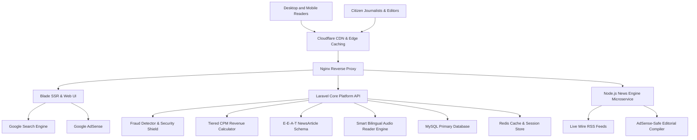

# Jagatbarta Platform

[](LICENSE)
[](https://nodejs.org/)
[](packages/core-engine)
[](https://jagatbarta.com)

A high-concurrency digital publishing platform and monetization ecosystem designed for scalable media operations, automated news curation, anti-fraud engagement analytics, and strict Google AdSense E-E-A-T compliance.

---

## Overview

Jagatbarta is structured as a modular digital publishing ecosystem that addresses four critical challenges in online media:

1. **Automated News Ingestion & Editorial Safety:** Live aggregation from national news wires coupled with an AI editorial compiler that enforces human journalistic voice and zero-hallucination policies.
2. **Monetization & Anti-Fraud Infrastructure:** A country-tiered CPM revenue engine with HMAC-SHA256 IP anonymization, proxy/datacenter detection, minimum dwell-time validation, and automated bot mitigation.
3. **Search Authority & E-E-A-T Architecture:** Dynamic injection of Schema.org `NewsArticle` JSON-LD structured data linking verified author credentials, microdata, and chunked XML sitemaps.
4. **Accessibility & Engagement Architecture:** In-browser bilingual Web Speech audio reader (`bn-BD` / `en-US`) that elevates reader dwell-time and AdSense Active View viewability while strictly isolating advertising units.

---

## System Architecture



---

## Core Modules

### 1. News Engine Microservice (`services/news-engine`)
* **Real-time Feed Streaming:** Parses high-frequency RSS feeds from leading national dailies (Google News BD, Prothom Alo, Daily Star).
* **AdSense Policy Guard:** Automatically screens topics against prohibited sensitive keywords to protect publisher advertising health.
* **Semantic Content Compiler:** Compiles publication-ready HTML with automated Table of Contents anchors and FAQ schemas.

### 2. Core Business Engine (`packages/core-engine`)
* **`FraudDetector`:** Validates engaged human reading sessions using dwell-time thresholds (>= 12s), scroll depth metrics, datacenter/proxy IP mitigation, and Google reCAPTCHA v3 risk scores.
* **`AudioContentEngine`:** Performs Unicode language classification (`bn-BD` vs `en-US`), strips ad tags/scripts to maintain AdSense safety, and chunks utterances by sentence punctuation to eliminate speech synthesis buffer freezes.
* **`CpmCalculator`:** Computes weighted CPM revenue based on geographical tiers (Tier 1: US/UK/CA, Tier 2: EU/Gulf, Tier 3: BD/IN) and device modifiers.
* **`EeatSchemaBuilder`:** Produces Google Search Central-compliant `NewsArticle` JSON-LD schemas linking author credentials and social verification arrays.

---

## Repository Structure

```text
jagatbarta-platform/
├── docs/                       # Technical Specifications & System Design
│   ├── ARCHITECTURE.md         # Component breakdown and data flow
│   ├── EARNING-SYSTEM.md       # CPM mathematical formula and tier matrix
│   ├── SECURITY.md             # RBAC, GDPR IP hashing, and publisher safeguards
│   ├── FEATURES.md             # Exhaustive production feature breakdown
│   ├── CHANGELOG.md            # Semantic versioning release log
│   └── API-SPECIFICATION.md    # REST API endpoints and payload schemas
├── packages/
│   └── core-engine/            # Tested Core Business Logic
│       ├── src/                # CpmCalculator, FraudDetector, AudioContentEngine, EeatSchemaBuilder
│       └── tests/              # Native unit test suite (15 passing)
└── services/
    └── news-engine/            # Node.js News Aggregator & UI Deck
        ├── public/             # Responsive dark UI dashboard
        └── server.js           # Feed streamer and prompt generator
```

---

## Quickstart

### Running Unit Tests
The core business engine uses Node's native test runner without third-party dependencies:

```bash
cd packages/core-engine
npm test
```

### Running the News Engine Microservice
Launch the local curation deck and prompt compiler on `http://localhost:3000`:

```bash
cd services/news-engine
npm install
npm start
```

---

## Revenue & Monetization Model

Platform earnings follow a verified-engagement CPM model:

$$\text{Earnings} = \left( \frac{\text{Verified Impressions}}{1000} \right) \times \text{Base CPM}_{\text{Tier}} \times \text{Device Multiplier}$$

* **Tier 1 (US, UK, CA, AU, EU-West):** Base CPM \$4.50
* **Tier 2 (Gulf Cooperation Council, Singapore, Japan):** Base CPM \$1.80
* **Tier 3 (South Asia, Rest of World):** Base CPM \$0.65
* **Engaged Reading Threshold:** Minimum 12-second active dwell time + 25% vertical scroll depth.

*Detailed specifications are available in [docs/EARNING-SYSTEM.md](docs/EARNING-SYSTEM.md).*

---

## Technical Specifications & Documentation

* [System Architecture & Data Flow](docs/ARCHITECTURE.md)
* [Monetization & Anti-Fraud Algorithms](docs/EARNING-SYSTEM.md)
* [Security, Privacy & AdSense Policy](docs/SECURITY.md)
* [REST API Specification](docs/API-SPECIFICATION.md)

---

## Author & Maintainer

**Md Shajib Sikder**  
* Founder & Lead Architect, Jagatbarta  
* GitHub: [@shajibsikder](https://github.com/shajibsikder)  
* Production Platform: [jagatbarta.com](https://jagatbarta.com)

---

## License

This project is licensed under the MIT License - see the [LICENSE](LICENSE) file for details.
