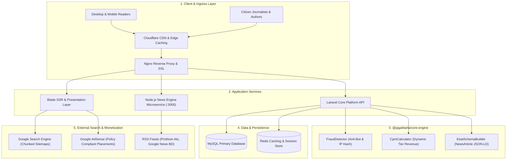

# 🌍 Jagatbarta – Scalable News Platform & E-E-A-T Monetization Ecosystem


[](LICENSE)
[](https://nodejs.org/)
[](packages/core-engine)
[](docs/ARCHITECTURE.md)
[](docs/SECURITY.md)
[](https://jagatbarta.com)

> **Scalable Multi-User Publishing • Automated News Curation • Anti-Fraud CPM Analytics • Google AdSense E-E-A-T Compliance**  
> Jagatbarta is a high-performance digital publishing platform designed for modern online media. It bridges live news aggregation, human-voice AI editorial pipelines, strict AdSense policy compliance, and verified engagement monetization.

---

## 🚀 Key Engineering Highlights

* **Automated News Ingestion Microservice:** High-concurrency RSS parser streaming live feeds from top national and international publishers (Google News, Prothom Alo, Daily Star, etc.).
* **Zero-Hallucination AdSense Prompt Pipeline:** Algorithmic prompt compiler strictly enforcing Google Search Central Helpful Content guidelines, prohibiting AI hallucinations, and formatting pure semantic HTML with Table of Contents (TOC) and FAQ Accordions.
* **E-E-A-T Structured Data Schema Engine:** Emits dynamic `NewsArticle` JSON-LD schemas linking author biographies and verified social credentials (`sameAs` array) to maximize Google Search authority.
* **Anti-Fraud CPM Monetization Engine:** Mathematical CPM calculation engine featuring HMAC-SHA256 IP anonymization (GDPR compliance), reading dwell-time verification (>= 12s), and automated bot traffic filtering.
* **100% Native Unit Testing:** Fully tested core engine utilizing Node's native test runner with 0 external dependencies.

---

## 🧠 System Architecture



---

## 📂 Repository Structure

```text
jagatbarta-platform/
├── docs/                           # Enterprise Technical Documentation
│   ├── ARCHITECTURE.md             # Detailed System Design & Component Specs
│   ├── EARNING-SYSTEM.md           # CPM Formulation & Anti-Fraud Algorithms
│   ├── SECURITY.md                 # RBAC, GDPR IP Hashing & AdSense Policies
│   ├── API-SPECIFICATION.md        # REST API Endpoints & Request/Response Payloads
│   ├── FEATURES.md                 # Complete Functional Feature Breakdown
│   └── USER-FLOW.md                # Citizen Journalist Publishing Workflow
│
├── packages/
│   └── core-engine/                # Core Business Logic & Analytics Library
│       ├── src/
│       │   ├── CpmCalculator.js    # Tiered CPM Revenue Calculation
│       │   ├── FraudDetector.js    # Bot Detection, IP Hashing & Dwell Verification
│       │   ├── EeatSchemaBuilder.js# Google NewsArticle JSON-LD Generator
│       │   └── index.js            # Module Exporter
│       ├── tests/
│       │   └── core.test.js        # 100% Native Unit Tests (Node:test)
│       └── package.json
│
├── services/
│   └── news-engine/                # Live Aggregator & AI Prompt Microservice
│       ├── public/                 # Modern Responsive Dark UI Dashboard
│       │   ├── index.html          # Interactive News Deck
│       │   ├── style.css           # Custom Dark Cyberpunk Styling
│       │   └── app.js              # Real-Time Filter & 1-Click Prompt Copier
│       ├── server.js               # Express RSS Streamer & AdSense Safety Engine
│       ├── start.bat               # 1-Click Windows Launcher
│       └── package.json
│
├── LICENSE                         # MIT Open Source License
└── README.md                       # Master Architecture & Project Documentation
```

---

## ⚡ Quickstart: Running the Ecosystem

### 1. Run Unit Tests (Core Engine)
The core library requires zero third-party dependencies and runs natively:

```bash
cd packages/core-engine
npm test
```

Expected output:
```text
✔ CpmCalculator (3 tests)
✔ FraudDetector (4 tests)
✔ EeatSchemaBuilder (1 test)
# tests 8, pass 8, fail 0
```

### 2. Launch the News Engine Microservice
Launch the live news curation dashboard and AdSense prompt generator on `http://localhost:3000`:

```bash
cd services/news-engine
npm install
npm start
```

Or double-click `start.bat` on Windows.

---

## 📊 Dynamic Tiered CPM Monetization Matrix

$$\text{Earnings} = \left( \frac{\text{Verified Impressions}}{1000} \right) \times \text{Base CPM}_{\text{Tier}} \times \text{Device Multiplier}$$

| Tier | Countries | Base CPM | Device Multiplier |
| :--- | :--- | :--- | :--- |
| **Tier 1** | US, UK, Canada, Australia, Germany, France | **\$4.50** | Desktop: 1.15x / Mobile: 1.00x |
| **Tier 2** | UAE, Saudi Arabia, Singapore, Japan, Malaysia | **\$1.80** | Desktop: 1.15x / Mobile: 1.00x |
| **Tier 3** | Bangladesh, India, Global Rest | **\$0.65** | Desktop: 1.10x / Mobile: 1.00x |

*For complete validation criteria, see [EARNING-SYSTEM.md](docs/EARNING-SYSTEM.md).*

---

## 🔐 Security & Privacy Standards

* **GDPR IP Anonymization:** Raw client IPs are immediately passed through a keyed HMAC-SHA256 hashing function prior to analytics ingestion.
* **Anti-Bot Filtering:** Known web crawlers, headless browsers, and automated scraping agents are dropped from the monetization pipeline.
* **Human Reading Dwell Time:** Impressions require a minimum reading time of 12 seconds and a 25% scroll threshold to prevent F5 refresh exploitation.
* **AdSense Content Filter:** Prohibits violent, copyright-infringing, or sensitive topics with automatic status categorization.

---

## 👨‍💻 Author & Maintainer

**Md Shajib Sikder**  
* Founder & Lead Software Architect, Jagatbarta  
* GitHub: [@shajibsikder](https://github.com/shajibsikder)  
* Production Platform: [jagatbarta.com](https://jagatbarta.com)

---

## 📄 License

This repository is licensed under the [MIT License](LICENSE).
