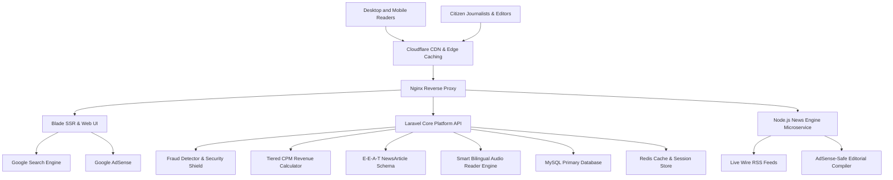
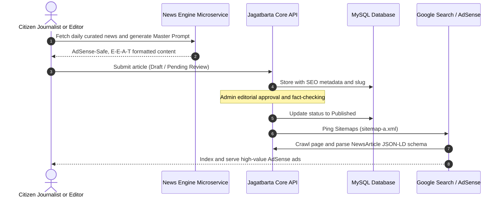

# Jagatbarta System Architecture

This document provides a comprehensive technical overview of the Jagatbarta digital news and content monetization ecosystem.

---

## 1. High-Level Architecture Diagram

---

## 2. Component Breakdown

### A. Ingress & Delivery Layer
* **Cloudflare CDN:** Edge caching for static assets, DDoS mitigation, and global SSL termination.
* **Nginx Reverse Proxy:** Routes public traffic to the Laravel application (`PHP-FPM`) and proxies microservice calls to the internal Node.js News Engine (`127.0.0.1:3000`).

### B. Core Application (Laravel & Blade SSR)
* **Author E-E-A-T Framework:** Dynamically links author profiles with social media verification (`sameAs` schema) and verified journalist biographies.
* **Multi-Sitemap Generator:** Automatically produces chunked XML sitemaps:
  * `sitemap-main.xml` (Index)
  * `sitemap-a.xml` (Articles)
  * `sitemap.xml` (Core Pages)
  * `sitemap-1.xml` (Categories, Authors, Tags)
* **Table of Contents (TOC) & FAQ Engine:** Automatically renders in-article navigational anchor trees (`<h2>`/`<h3>`) and interactive FAQ accordions.

### C. News Engine Microservice (`services/news-engine`)
* **Real-time Feed Streaming:** Parses multi-source national and international RSS feeds.
* **AdSense Content Safety Guard:** Filters sensitive, violent, or policy-violating topics using automated keyword heuristics (`isAdSenseHighValue`).
* **Zero-Hallucination Prompt Builder:** Emits structured prompts for LLMs enforcing human journalistic voice, strict source attribution, and table-of-contents formatting.

### D. Core Business Engine (`packages/core-engine`)
* **`FraudDetector`:** Validates engaged human reading sessions using dwell-time thresholds (>= 12s), scroll depth (>= 25%), and bot user-agent filtering.
* **`CpmCalculator`:** Computes weighted CPM revenue based on geographical tiers (Tier 1: US/UK/CA; Tier 2: EU/Gulf; Tier 3: BD/IN) and device modifiers.
* **`EeatSchemaBuilder`:** Emits Google Search Central-compliant `NewsArticle` JSON-LD schemas with dynamic author credentials.

---

## 3. Data Flow: Article Publishing to Google Indexing

