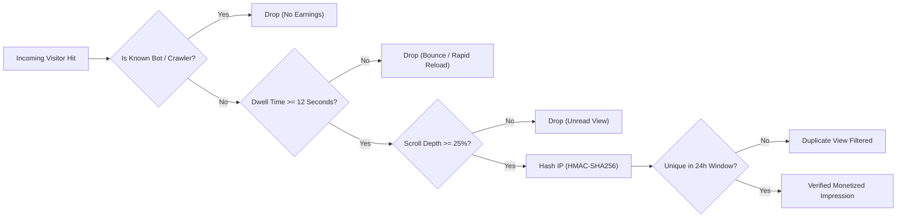

# 💰 Jagatbarta Earning System Specification

This document details the mathematical models, fraud prevention rules, and monetization mechanics implemented in the Jagatbarta platform.

---

## 1. Monetization Formula

Platform revenue is calculated using a **Dynamic Tiered CPM (Cost Per Mille / Thousand Impressions)** model:

$$\text{Earnings} = \left( \frac{\text{Verified Impressions}}{1000} \right) \times \text{Base CPM}_{\text{Tier}} \times \text{Device Multiplier}$$

### Tier Rate Matrix (USD per 1,000 Verified Views)

| Tier | Target Regions / Countries | Base CPM | Device Multiplier (Desktop / Mobile) |
| :--- | :--- | :--- | :--- |
| **Tier 1** | United States (US), United Kingdom (GB), Canada (CA), Australia (AU), Germany (DE), France (FR) | **\$4.50** | Desktop: 1.15x / Mobile: 1.00x |
| **Tier 2** | UAE (AE), Saudi Arabia (SA), Singapore (SG), Japan (JP), Malaysia (MY), Italy (IT), Spain (ES) | **\$1.80** | Desktop: 1.15x / Mobile: 1.00x |
| **Tier 3** | Bangladesh (BD), India (IN), Pakistan (PK), Global Rest | **\$0.65** | Desktop: 1.10x / Mobile: 1.00x |

---

## 2. Impression Verification & Anti-Fraud Shield

To protect advertiser ROI and maintain Google AdSense policy compliance, the platform enforces strict criteria before an impression is credited:

### Verification Criteria:
1. **Dwell Time Threshold:** The visitor must maintain an active engaged session on the article page for at least **12 seconds**.
2. **Scroll Engagement:** The visitor must scroll through at least **25%** of the article content.
3. **Unique Frequency Cap:** Only 1 monetized view is counted per hashed IP per article within a 24-hour rolling window.
4. **GDPR-Compliant IP Anonymization:** Raw IP addresses are immediately hashed with cryptographic HMAC-SHA256 and salt before storage.

---

## 3. Payout & Withdrawal Workflow

* **Minimum Payout Threshold:** \$10.00 USD (or equivalent in BDT via bKash, Nagad, or Bank Transfer).
* **Payment Methods:** Mobile Financial Services (bKash, Nagad, Rocket) and Domestic Bank Wire.
* **Audit Trail:** Every withdrawal request undergoes an administrative anti-fraud review to verify analytics integrity prior to fund disbursement.
